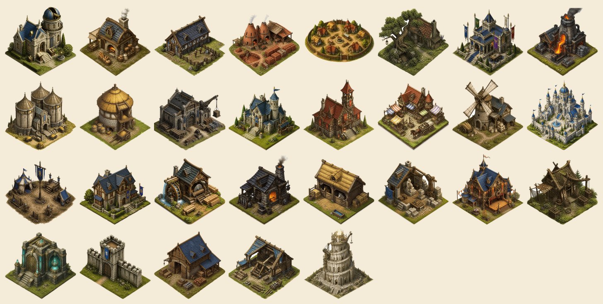
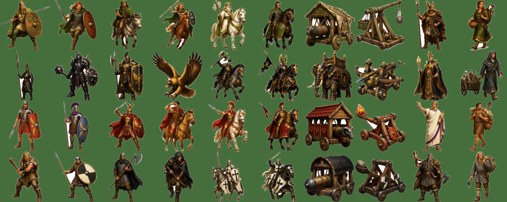
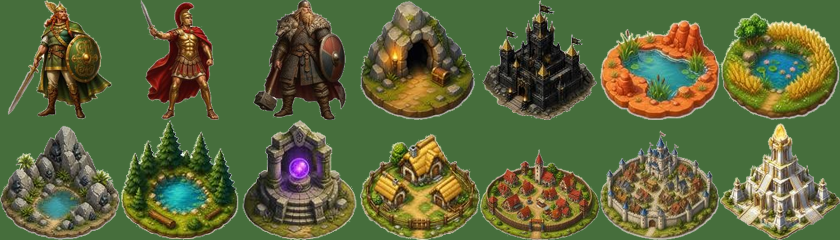
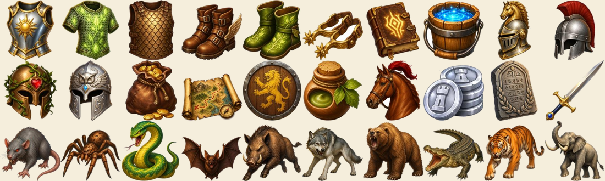
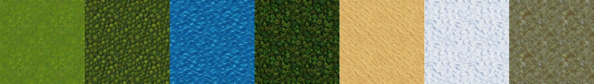

# Quatre Champs : images médiévales libres (CC0)

Plus de 150 images de jeu de stratégie médiéval, **libres et gratuites pour tous**, y compris pour un usage commercial, sans obligation de citer la source : licence **CC0 1.0** (domaine public). Elles viennent du jeu par navigateur **Quatre Champs**. Un lien vers ce dépôt fait toujours plaisir.

## Contenu

| Dossier | Contenu | Nombre | Origine |
|---|---|---|---|
| `batiments/` | Bâtiments isométriques sur fond transparent : bâtiment principal, caserne, écurie, marché, palais, merveille… | 28 | Générés par IA (Canva), détourés |
| `unites/` | Unités de 4 peuples (Romains, Gaulois, Germains, Natars), nommées `u2_<peuple>_<n°>.png` | 40 | Générées par IA (Canva), détourées |
| `heros/` | Un héros par peuple | 3 | Générés par IA (Canva), détourés |
| `objets/` | Équipement du héros (casques, armes, armures, bottes, monture), consommables, pièce d’argent | 20 | Générés par IA (Canva), détourés |
| `animaux/` | Animaux des oasis, du rat à l’éléphant | 10 | Générés par IA (Canva), détourés |
| `carte/` | Icônes de carte : villages (3 tailles), oasis (4), forteresse, merveille, trésor, aventure | 11 | Générées par IA (Canva), détourées |
| `terrains/` | Textures de carte raccordables : herbe, forêt, mer, jungle, désert, neige, toundra | 7 | Générées par IA (Canva), rendues raccordables |
| `champs/` | Champs de ressources (bois, argile, fer, céréales), 4 stades | 16 | Peints par programme |
| `icones/` | Icônes de ressources et d’interface | 18 | Peintes par programme |
| `fonds/` | Fonds de pages et du village | 3 | Peints par programme |

Formats : PNG à fond transparent (sauf terrains et fonds), environ 200 px de côté pour les images IA.

## Aperçus

**Bâtiments**

**Unités**

**Héros et icônes de carte**

**Objets du héros et animaux**

**Terrains**

## Transparence

Les images des dossiers `batiments/`, `unites/`, `heros/`, `objets/`, `animaux/`, `carte/` et `terrains/` ont été créées par une intelligence artificielle (Canva). Merci de ne pas les présenter comme dessinées à la main. Elles ne reprennent aucun graphisme d’un autre jeu.

## Licence

[CC0 1.0 Universel](https://creativecommons.org/publicdomain/zero/1.0/deed.fr) : vous pouvez copier, modifier, distribuer et utiliser ces images, même à des fins commerciales, sans demander la permission. Voir `LICENSE`.

---

# Quatre Champs: free medieval game images (CC0)

More than 150 medieval strategy game images, **free for everyone**, including commercial use, no attribution required (**CC0 1.0**, public domain). They come from the browser game **Quatre Champs**.

Contents: 28 isometric buildings, 40 units (Romans, Gauls, Teutons, Natars), 3 heroes, 20 hero items, 10 oasis animals, 11 map icons, 7 seamless terrain textures, plus resource fields, icons and backgrounds.

The buildings, units, heroes, items, animals, map icons and terrain textures are **AI-generated** (Canva); please do not present them as hand-drawn. The other folders were painted procedurally.
