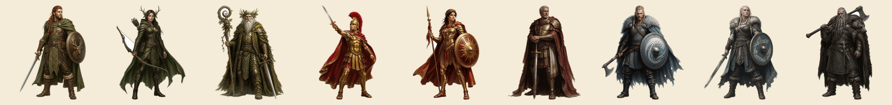
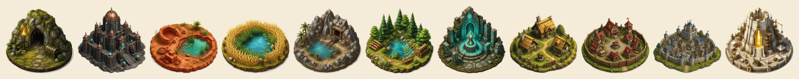
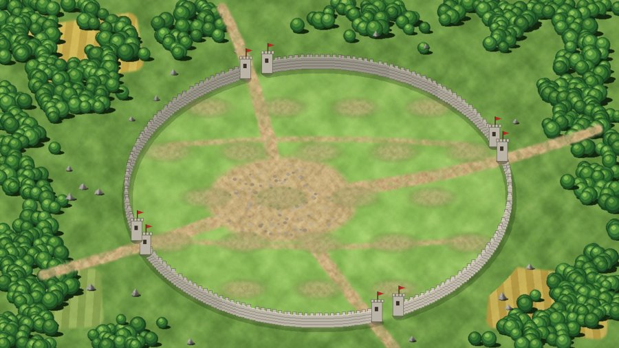

# Images de jeu de stratégie médiéval libres (CC0)

Plus de 170 images de jeu de stratégie médiéval, **libres et gratuites pour tous**, y compris pour un usage commercial, sans obligation de citer la source : licence **CC0 1.0** (domaine public). Elles viennent de **Terres de Bannières**, un jeu de stratégie médiéval par navigateur, sans or ni pay-to-win, sur une vraie carte du monde (serveur Discord : https://discord.gg/PE8FbaXEmx). Un lien vers ce dépôt fait toujours plaisir.

## Contenu

| Dossier | Contenu | Nombre | Origine |
|---|---|---|---|
| `batiments/` | Bâtiments isométriques sur fond transparent : bâtiment principal, caserne, écurie, marché, palais, merveille… et un centre de village complet | 30 | Générés par IA (Canva), détourés, **HD 360 px** (dont le port `b_harbor`) |
| `unites/` | Unités de 4 peuples (Romains, Gaulois, Germains, Natars), nommées `u2_<peuple>_<n°>.png` | 40 | Générées par IA (Canva), détourées, **HD 320 px** |
| `heros/` | Héros des 3 peuples, 3 portraits chacun : classique, héroïne, vétéran (`h_<peuple>`, `_f`, `_o`) | 9 | Générés par IA (Canva), détourés, **HD 420 px** |
| `objets/` | Équipement du héros (casques, armes, armures, bottes, monture), consommables, pièce d’argent | 20 | Générés par IA (Canva), détourés |
| `animaux/` | Animaux des oasis, du rat à l’éléphant | 10 | Générés par IA (Canva), détourés |
| `carte/` | Icônes de carte : villages (3 tailles), oasis (4), forteresse, merveille, trésor, aventure | 12 | Générées par IA (Canva), détourées, **HD 260 px** (dont le port gardé `m_port`) |
| `terrains/` | Textures de carte raccordables : herbe, forêt, mer, jungle, désert, neige, toundra | 7 | Générées par IA (Canva), rendues raccordables |
| `interface/` | Icônes de navigation peintes : champs, village, carte, classement, rapports, alliance | 6 | Générées par IA (Canva), détourées |
| `champs/` | Champs de ressources (bois, argile, fer, céréales), 4 stades | 16 | Peints par programme |
| `icones/` | Icônes de ressources et d’interface | 18 | Peintes par programme |
| `fonds/` | Fonds de pages, de la vue des champs et du village (dont `village_bg3.jpg`, 1280×720) | 4 | Peints par programme |
| `remparts/` | Remparts du village à superposer au fond (`wall_roman`, `wall_gaul`, `wall_teuton`), 1280×720, fond transparent | 3 | Peints par programme |
| `logo.png` | Logo du jeu Terres de Bannières | 1 | Généré par IA (Canva), détouré |

Formats : PNG à fond transparent (sauf terrains et fonds). Bâtiments, unités, héros et icônes de carte en HD (260 à 420 px) ; objets et animaux environ 200 px.

## Aperçus

**Bâtiments**

**Unités**

**Héros (9 portraits)**

**Icônes de carte**

**Village avec rempart**

**Héros et icônes de carte**

**Objets du héros et animaux**

**Terrains**

## Transparence

Les images des dossiers `batiments/`, `unites/`, `heros/`, `objets/`, `animaux/`, `carte/`, `terrains/` et `interface/`, ainsi que `logo.png`, ont été créées par une intelligence artificielle (Canva). Merci de ne pas les présenter comme dessinées à la main. Elles ne reprennent aucun graphisme d’un autre jeu.

## Licence

[CC0 1.0 Universel](https://creativecommons.org/publicdomain/zero/1.0/deed.fr) : vous pouvez copier, modifier, distribuer et utiliser ces images, même à des fins commerciales, sans demander la permission. Voir `LICENSE`.

---

# Free medieval strategy game images (CC0)

More than 170 medieval strategy game images, **free for everyone**, including commercial use, no attribution required (**CC0 1.0**, public domain). They come from **Terres de Bannières**, a browser medieval strategy game with no gold and no pay-to-win, on a real world map (Discord: https://discord.gg/PE8FbaXEmx).

Contents: 29 isometric buildings (including a full village centre), 6 navigation icons, 40 units (Romans, Gauls, Teutons, Natars), 9 hero portraits (3 per tribe: classic, heroine, veteran), 20 hero items, 10 oasis animals, 11 map icons (buildings, units, heroes and map icons now in HD, 260–420 px), 3 village walls, the game logo, 7 seamless terrain textures, plus resource fields, icons and backgrounds.

The buildings, units, heroes, items, animals, map icons and terrain textures are **AI-generated** (Canva); please do not present them as hand-drawn. The other folders were painted procedurally.
